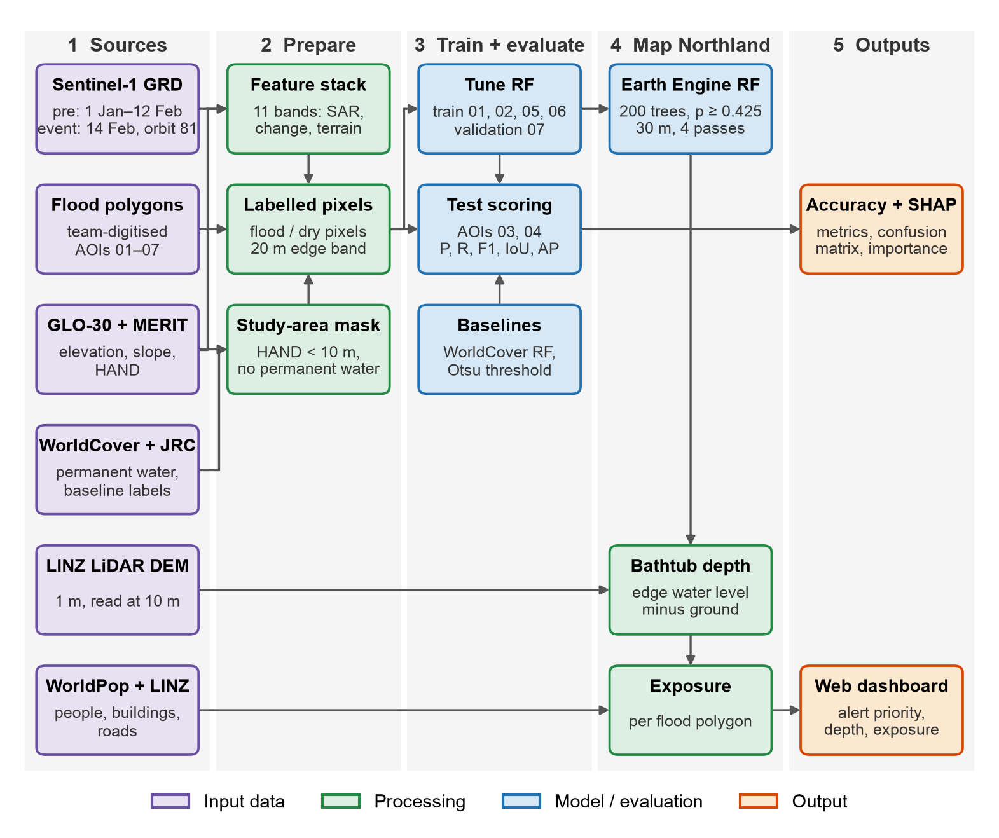
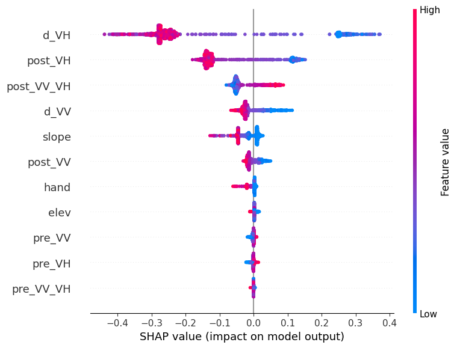

# Flood Response Control Tower: Northland

A static, interactive map for exploring flood extent and exposure in Northland, New Zealand, from Sentinel-1 radar. Built for GEOG761 (Group 05).

> **Retrospective analysis, not a live feed.** The flood extent is a model estimate, checked only against unverified reference polygons. Confirm on the ground before acting on anything shown.

## What it shows

- **Alert queue:** every flood polygon is an alert with a priority (Critical, High, Moderate, Low). Sort by life safety, infrastructure or hazard depth; filter by priority or status; search by alert ID.
- **Map:** flood polygons coloured by priority or by mean depth, with dark and satellite basemaps.
- **Incident detail:** area, depth, people, buildings (and named uses such as schools), road length, recommended actions, a status flow (New, Acknowledged, Dispatched, Resolved), and a Navigate link.
- **Dates:** four Sentinel-1 passes during Cyclone Gabrielle (11, 14, 18, 19 Feb 2023). 14 Feb is the event pass.
- **Method & accuracy:** which model made the map, its inputs, accuracy figures and caveats.

## Files

| File | What it is |
|---|---|
| `index.html` | The page and all its code |
| `flood-data.js` | Summary figures and the 14 Feb event polygons |
| `multiday-data.js` | The 11, 18 and 19 Feb polygons and per-date totals |
| `data/` | Source files the `.js` files were built from (not loaded by the page; optional) |

Leaflet and the Esri map tiles load from the internet.

## Run it

Open `index.html` in a browser. No build step and no server are needed.

**Host on GitHub Pages:** put `index.html`, `flood-data.js` and `multiday-data.js` in the same folder of a repo, then go to Settings → Pages and publish that folder.

## Pipeline

*The diagram shows the single-event pipeline (14 Feb pass). The other dates reuse the trained model; see Limitations.*

## Method

- **Model:** Polygon RF, a Random Forest (Earth Engine `smileRandomForest`, probability mode, 200 trees, minimum leaf size 5). A pixel is flood if its probability is 0.425 or higher. It is trained on reference flood polygons from AOIs 01, 02, 05 and 06.
- **Inputs (11 bands):** Sentinel-1 VV, VH and VV−VH for the pass and for a pre-event median from the same orbit; the change in VV and VH; elevation, slope and HAND (height above nearest drainage).
- **Study area:** floodable ground only (HAND below the cut-off, not permanent water). Very small patches are dropped. Output is at 30 m.
- **Depth:** a bathtub estimate on the LINZ LiDAR DEM. It is not part of the Random Forest.
- **Exposure:** people from WorldPop 2020 (approximate); buildings and road length from LINZ.
- **Accuracy (event pass, held-out test AOIs 03 and 04):**

| Method | Precision | Recall | F1 | IoU |
|---|---|---|---|---|
| Polygon RF (used on the map) | 0.849 | 0.922 | 0.884 | 0.792 |
| WorldCover RF (baseline) | 0.722 | 0.820 | 0.768 | 0.623 |
| Otsu (baseline) | 0.661 | 0.325 | 0.436 | 0.278 |

These scores come from the scikit-learn version used for tuning. The Earth Engine version that made the map scored almost the same (test average precision 0.954 vs 0.952).

- **Feature importance (SHAP):** mean absolute SHAP value of each band on the flood probability, for the scikit-learn Polygon RF on a test-pixel sample (up to 2,000). The change in VH backscatter dominates: a large drop in VH (low `d_VH`) and a low event VH push the model towards flood. The pre-event bands add almost nothing on their own, since the change bands already carry that information.

| Rank | Band | Mean abs SHAP |
|---|---|---|
| 1 | d_VH | 0.265 |
| 2 | post_VH | 0.127 |
| 3 | post_VV_VH | 0.050 |
| 4 | d_VV | 0.029 |
| 5 | slope | 0.023 |
| 6 | post_VV | 0.016 |
| 7 | hand | 0.007 |
| 8 | elev | 0.004 |
| 9 | pre_VV | 0.002 |
| 10 | pre_VH | 0.002 |
| 11 | pre_VV_VH | 0.0004 |

## Performance

Wall-clock timings from `latency_shap.ipynb` on Google Colab. Earth Engine runs the model server-side and is lazy, so its times include network and, for Northland, the GeoTIFF download.

| Step | Time |
|---|---|
| scikit-learn: train Polygon RF (200 trees) | 1.2 s |
| scikit-learn: inference on the test pixels (~12,000), median of 5 | 0.10 s (8.5 ms per 1,000 pixels) |
| Earth Engine: train, classify the test pixels and fetch | 78.9 s |
| Earth Engine: classify and download Northland, one pass (30 m) | 332 s (about 5.5 min) |

Only one run was timed, and Earth Engine times vary with server load. The page is static, so there is no server-side latency once the polygons are built; everything after the notebook run is client-side. Depth, exposure and export timings were not measured.

## Alert priority

Rule-based on exposure counts (not a model). The first rule that matches decides it:

| Priority | Any of |
|---|---|
| Critical | named critical use (e.g. school), or 10 or more buildings, or 25 or more people |
| High | 3 or more buildings, or 5 or more people, or 1 km or more of road |
| Moderate | any building or road |
| Low | none of the above |

Thresholds are set in the `level` function in `index.html`. Alert status is saved in the viewer's own browser only.

## Limitations

- The reference polygons come from an external, unverified source and were made from the same Sentinel-1 pass the model uses. The accuracy figures measure agreement with that reference, not independent accuracy.
- The model was trained on the 14 Feb pass (orbit 81) only. The other dates use different orbits and viewing angles, so those maps are unvalidated and have no reference. Single-scene passes (11 and 18 Feb) likely cover only part of Northland, so their totals are not comparable with the event pass.
- There is no Sentinel-1 pass over Northland on 12 or 13 Feb, so the build-up to the peak cannot be shown. The 18 and 19 Feb maps show water remaining after the event, not new flooding.
- SAR under-detects flooding in built-up areas and under vegetation.
- Depth assumes a flat water surface and ignores flow.
- Most LINZ buildings have no recorded use, so building types are mostly "Unclassified".
- The pass dates were chosen from what Sentinel-1 acquired over Northland; the flood peak may fall between passes.

## Data sources

| Data | Source |
|---|---|
| Radar | Sentinel-1 GRD (ESA Copernicus), via Google Earth Engine |
| Elevation (model input) | Copernicus GLO-30 DEM |
| Height above nearest drainage | MERIT Hydro v1.0.1 |
| Permanent water | ESA WorldCover v200 (2021) and JRC Global Surface Water |
| Elevation (depth) | LINZ NZ LiDAR DEM |
| Population | WorldPop 2020, 100 m |
| Buildings | LINZ NZ Building Outlines |
| Roads | LINZ NZ Road Centrelines (Topo 1:50k) |
| Flood reference polygons | External source (unverified), used for training and testing only |
| Basemap | Esri World Dark Gray Base and World Imagery |

## Updating the data

The polygons are produced in Google Colab by `flood_event_pipeline.ipynb` (event pass, and the multi-day cell at the end of that notebook). The notebook writes one compact JSON file per date and `multiday_summary.csv`. The `.js` files in this folder are built from those outputs.
